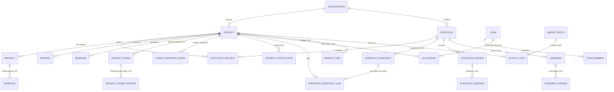

# PPM Athena — 03. Modèle de données

## Résumé

1. **Peu d'objets nouveaux en V1** : quatre colonnes sur `project`, plus trois tables : phases datées, météo du projet, instantanés de portefeuille. Le reste réutilise l'existant (portefeuille du lot 16, versions, baselines, trackers de risques).
2. **Aucune copie** : un indicateur de projet (retard, avancement, santé) n'est jamais stocké au portefeuille, sauf dans un instantané, qui est un fait daté et voulu.
3. **Granularité** (semaine ou mois) : réglage d'affichage et de saisie, porté par le projet et par le portefeuille. Le stockage reste en dates et en heures.
4. **Capacité (V2)** : disponibilité par personne, absences, allocations nominatives ou par rôle, worklog. **Finances (V2)** : lignes de budget, engagements, réels, prévisions, lots d'import.
5. **Visibilité** : toute table qui porte un `project_id` reçoit la politique restrictive `acl_allows(project_id, null)`, et tout agrégat se calcule sous l'identité du lecteur. C'est désormais une règle de revue de code.
6. **Scénarios (V3)** : tables séparées de surcharges, jamais écrites dans les tables de référence.
7. **Décisions prises le 2026-11-15** : durée de la journée en heures et minutes, réglable par l'organisation et par personne (§ 2.9) ; cycle de vie du projet configurable par l'organisation, avec treize états livrés par défaut (§ 2.1) ; rétention des instantanés réglable (§ 2.5) ; rôle PMO créé ; volumétrie du palier 2.

Légende : **E** = existant (fichier cité), **X** = existant étendu, **N** = nouveau. Version cible entre crochets.

---

## 1. Objets opérationnels existants à référencer

| Objet | Table | Fichier | Rôle pour le PPM |
|---|---|---|---|
| Organisation | `organization` | `001_core.sql` | Périmètre de l'instance ; calendrier ; réglages de capacité (V2) |
| Projet | `project` | `001_core.sql:23-31`, `037:29-33` | Unité agrégée ; étendu en V1 (§ 2.1) |
| Ticket | `artifact` | `002_artifacts.sql` | Charge restante, échéances, risques, actions, décisions, demandes (V3) |
| Champ, rôle sémantique | `field_definition.semantic_role` | `058_planning_model.sql:6` | Étendu par `probability` et `impact` (P5) |
| Version (jalon daté) | `release` | `016_reporting.sql:5-18` | Jalons de la roadmap |
| Baseline | `baseline`, `baseline_schedule` | `012`, `060` | Plan de référence de la roadmap et écarts |
| Lien « précède » | `artifact_link` + `link_type.ordered` | `058` | Étendu aux liens entre projets (P3, V2) |
| Gabarit normatif, phase courante | `project_template_version`, `project.current_phase` | `037` | Liste des phases et revues du cycle de vie |
| Confirmation de critère | `phase_criterion_check` | `064_gate_checks_acl.sql` | Gates : critères manuels datés et nominatifs |
| Équipe | `team`, `team_member` | `063` | Regroupement de la capacité (V2) |
| Portefeuille | `portfolio`, `portfolio_project` | `063` | Socle ; étendu (§ 2.2) |
| Calendrier | `organization_calendar`, `calendar_holiday` | `059` | Jours ouvrés, conversion des périodes |
| Tableau de bord | `dashboard_layout` | `050`, `051`, `057` | Nouvelle portée `portfolio:<clé>` |
| Audit | `audit_log` | `003` | Toute écriture PPM |

## 2. Objets nouveaux ou étendus

### 2.1 Projet [V1, X]

| Champ | Type | Règle |
|---|---|---|
| `planned_start`, `planned_end` | date, facultatives | Dates de référence macro, saisies par le chef de projet. Le planning détaillé reste maître de ses tickets. Un écart entre `planned_end` et la fin calculée (`computeSchedule`) se signale, sans correction automatique. |
| `lifecycle_state` | Clé d'un état de cycle de vie de l'organisation (§ 2.1 bis) | Défaut `in_progress` pour l'existant (migration de données). Les changements suivent les transitions permises. |
| `sponsor_subject` | texte, compte connu | Facultatif |
| `description` | texte ≤ 2 000 | — |
| `capacity_granularity` | `week`, `month`, ou nul | Nul : hérite du réglage de l'organisation |

- **Droits** : écriture par l'administrateur et le chef désigné du projet (`MemberService.requireManager`) ; lecture par tous ceux qui voient le projet.
- **Source de vérité** : le projet. **Audit** : `project.update`.

### 2.1 bis Cycle de vie du projet, configurable [V1, N]

Pour couvrir tous les cas (de l'idée à l'archivage, suspension et annulation comprises), la liste des états n'est pas figée dans le code. C'est une donnée de l'organisation, sur le modèle des types de tracker (`tracker-types.ts`) : des états livrés, que l'organisation peut renommer, compléter ou masquer.

`project_lifecycle_state(organization_id, key, name, category, position, color, hidden)` et `project_lifecycle_transition(from_key, to_key, roles)`.

Les **catégories** sont fixes : c'est sur elles, jamais sur les clés, que le code s'appuie.

| Catégorie | Comportement | États livrés (clé, nom) |
|---|---|---|
| `pipeline` | Hors charge et hors santé ; visible en pointillés sur la roadmap | `idea` Idée, `proposed` Proposé, `evaluation` En évaluation, `approved` Approuvé (non démarré) |
| `active` | Compté partout (santé, roadmap, capacité, finances) | `starting` En démarrage, `in_progress` En cours, `closing` En clôture |
| `suspended` | Compté, signalé ; allocations gelées ; alerte si l'état dure plus de N jours (réglable) | `on_hold` Suspendu, `awaiting_decision` En attente de décision |
| `closed` | Masqué par défaut, filtrable ; plus d'alerte | `completed` Terminé |
| `cancelled` | Masqué par défaut ; motif obligatoire | `cancelled` Annulé, `rejected` Refusé (pour une demande convertie, V3) |
| `archived` | Lecture seule, hors de toutes les vues sauf la recherche | `archived` Archivé |

- **Transitions livrées** :
  - le pipeline avance dans l'ordre ;
  - `approved` → `starting` → `in_progress` → `closing` → `completed` → `archived` ;
  - tout état actif → `on_hold` ou `awaiting_decision`, et retour ;
  - tout état non terminal → `cancelled`.
  - L'organisation peut en ajouter.
- **Droits par défaut** : le chef de projet conduit les transitions actives. Le PMO et l'administrateur décident de `approved`, `cancelled`, `completed` et `archived`. Une décision de portefeuille (V2) peut proposer une transition sans l'appliquer.
- **Lien avec les phases normatives** : indépendant. Le cycle de vie dit si le projet vit ; la phase (`current_phase`) dit où il en est techniquement. Un projet `in_progress` peut être en phase B ou D.
- **Historique** : `project_lifecycle_history(project_id, from, to, reason, by, at)`, en ajout seul. Il fournit la courbe des entrées et sorties et le délai passé dans chaque état.

### 2.2 Portefeuille [V1, X]

| Champ ajouté | Règle |
|---|---|
| `capacity_granularity` | `week` ou `month`, défaut `month` ; règle l'affichage des agrégats de capacité du portefeuille |
| `currency` [V2] | Code ISO 4217 ; un portefeuille n'agrège que des montants de sa devise (pas de conversion en V2) |

`portfolio_project` est inchangé ; sa politique restrictive a été posée en `064`.

### 2.3 Phase datée d'un projet [V1, N] (`project_phase`, P6)

| Champ | Règle |
|---|---|
| `project_id`, `phase` | La clé de phase doit exister dans la version de gabarit épinglée du projet |
| `planned_start`, `planned_end` | Facultatives ; `planned_end` est la date prévue de la revue de fin de phase |
| `review_planned_on`, `review_held_on` | Revue normative (SRR, PDR…) prévue et tenue |
| `decision` | `go`, `go_with_reserves`, `no_go`, nul ; prise au passage de phase |
| `decided_by`, `decided_at`, `note` | Obligatoires si `decision` est renseignée |

- `advancePhase` existant (`template-upgrade.service.ts`) écrit la décision et `review_held_on`, en plus de `current_phase`.
- **Historique** : la courbe de tendance des jalons (MTA) exige l'historique des dates prévues. Chaque modification de `planned_end` ou de `review_planned_on` ajoute une ligne à `project_phase_history(project_id, phase, field, old, new, changed_by, changed_at)`. Cette table est en ajout seul.
- **Droits** : écriture par le chef de projet et l'administrateur ; décision par la même population, ou par l'assurance qualité si le gabarit l'exige (le circuit d'approbation `041` existe).

### 2.4 Météo du projet [V1, N] (`project_status_note`)

C'est l'auto-évaluation périodique du chef de projet, distincte de la santé calculée.

| Champ | Règle |
|---|---|
| `project_id`, `written_at`, `author` | Une note par écriture ; la dernière fait foi |
| `schedule`, `scope`, `risk`, `resources`, `cost` | Chacun `ok`, `attention` ou `critical` ; `cost` et `resources` restent nuls tant que les données V2 n'existent pas |
| `comment` | ≤ 2 000 caractères |

- **Calcul** : aucun ; c'est une saisie. Le tableau de santé affiche côte à côte la santé **calculée** (`healthOf`) et la santé **déclarée**, et signale un écart entre les deux.
- **Droits** : écriture par le chef du projet ; lecture par ceux qui voient le projet. **Audit** : ajout seul.

### 2.5 Instantané de portefeuille [V1, N]

`portfolio_snapshot(id, portfolio_id, taken_at, kind weekly|review|manual, label, taken_by)`

`portfolio_snapshot_line(snapshot_id, project_id, metrics jsonb)` : `metrics` fige pour un projet la santé calculée et forcée, l'avancement, les tickets ouverts, en retard et bloqués, la phase, `planned_end`, la fin calculée, l'écart à la baseline, et la dernière météo (identifiant et niveaux).

- **Ce qui est figé** : uniquement des valeurs par projet. Aucun total n'est stocké : les totaux d'un instantané se recalculent à la lecture, sur les lignes visibles.
- **Quand** : chaque semaine (job), à la création d'une revue, ou à la demande du PMO.
- **Durée, réglable** : réglages de l'organisation `snapshot_weekly_retention_weeks` (défaut 26) et `snapshot_review_retention_months` (défaut nul, c'est-à-dire sans limite : ce sont des pièces de gouvernance). Un portefeuille peut surcharger ces deux valeurs. La purge est faite par le job des instantanés et tracée dans l'audit. La fréquence (`snapshot_frequency` : hebdomadaire par défaut, ou mensuelle) est réglable de la même façon.
- **Visibilité** : politique restrictive sur `portfolio_snapshot_line.project_id`.

### 2.6 Revue de portefeuille [V1 en lecture, V2 complète]

`portfolio_review(id, portfolio_id, held_on, snapshot_id, state draft|held, summary, created_by)`.

Les décisions de portefeuille (poursuivre, suspendre, arrêter) sont en **V2** : `portfolio_decision(id, portfolio_id, review_id, project_id, kind, rationale, conditions, owner, due_on, decided_by, decided_at)`. Une décision `suspend` ou `stop` propose le changement de `project.lifecycle_status`, sans l'imposer : c'est un acte du chef de projet ou de l'administrateur, tracé.

### 2.7 Risques consolidés [V1, X] (P5)

Ajouter `probability` et `impact` (entiers de 1 à 5) aux rôles sémantiques (`field_definition.semantic_role`). La criticité vaut probabilité × impact, calculée (paliers existants de `RisksTab.tsx:14`). Il n'y a **pas** de table de risques de portefeuille en V1. Un risque transverse est un ticket de type `risk` d'un projet de pilotage rattaché au portefeuille (V2) : même objet, même workflow.

### 2.8 Dépendances entre projets [V2, X] (P3)

Le lien « précède » accepte une cible dans un autre projet de la même organisation, si l'auteur voit les deux projets. La planification d'un projet traite un prédécesseur externe comme une **contrainte de date**, sans rien recalculer chez l'autre projet. La propagation inter-projets est un calcul de portefeuille, en lecture seule.

### 2.9 Capacité [V2, N]

| Entité | Champs principaux | Règles |
|---|---|---|
| `organization_capacity` | `workday_minutes` (défaut 468, soit 7 h 48), `default_granularity` | Unité de stockage : **la minute** (entier, sans arrondi). Toute durée se saisit et s'affiche en heures et minutes (« 7 h 48 », « 7 h 00 », « 8 h 00 »), entre 1 min et 24 h. Le jour vaut `workday_minutes` ; l'ETP d'une période vaut jours ouvrés × `workday_minutes`. |
| `person_availability` | `subject`, `from`, `to`, `ratio` (0 à 1), `workday_minutes` (facultatif) | Temps partiel ; durée de journée propre à la personne (contrat différent) si renseignée, sinon celle de l'organisation ; sans ligne, `ratio` vaut 1 |
| `absence` | `subject`, `from`, `to`, `kind` (congé, formation, autre), `half_day` | Retirée de la capacité ; le motif n'est visible que de la personne, de son manager et de l'administrateur |
| `allocation` | `project_id`, `subject` **ou** `team_id` + `role_label`, `from`, `to`, `fte` | Nominative (personne) ou générique (besoin d'un rôle dans une équipe), à temps partiel, sur plusieurs projets |
| `worklog` | `artifact_id`, `subject`, `day`, `minutes`, `comment` | Temps passé, saisi en heures et minutes ; source du « consommé » ; RLS par ticket (`acl_artifact_ok`) |

- **Capacité d'une personne sur une période** = jours ouvrés (calendrier) × `workday_minutes` (de la personne, sinon de l'organisation) × `ratio` − absences.
- **Charge planifiée** = allocations (ETP × capacité de la période).
- **Charge restante** = rôle `remaining` des tickets ouverts, **en minutes** (saisie en heures et minutes ; c'est la correction du risque 4 de la cartographie). Les valeurs existantes, sans unité, sont migrées après confirmation de leur unité par projet.
- **Charge consommée** = `worklog`.
- **Points de story** : tenus à part, jamais convertis en heures (la vélocité reste un indicateur d'équipe).
- **Granularité** : une période est une semaine ISO ou un mois civil. Le passage d'une semaine à cheval sur deux mois se fait au prorata des jours ouvrés. Le projet saisit dans sa granularité, et chaque portefeuille agrège dans la sienne.

### 2.10 Finances [V2, N]

| Entité | Champs principaux | Règles |
|---|---|---|
| `expense_category` | `key`, `name`, `kind` (interne, externe, licence, matériel, prestation) | Liste de l'organisation |
| `budget_line` | `project_id`, `category`, `phase` (facultatif), `kind` (initial, avenant, arbitrage), `amount`, `reason`, `decision_id` (facultatif) | Ajout seul ; budget courant = initial + avenants + arbitrages ; la cascade se lit directement |
| `commitment` | `project_id`, `category`, `amount`, `reference`, `committed_on` | Engagé (commande) |
| `actual_cost` | `project_id`, `category`, `period` (mois), `amount`, `source` manual\|import, `import_batch_id` | Réel |
| `forecast` | `project_id`, `category`, `period`, `amount` | Reste à dépenser prévu ; EAC = réel + prévisions futures |
| `import_batch` | `file_name`, `sha256`, `rows`, `errors`, `imported_by`, `imported_at` | Réimport idempotent par empreinte ; rejet ligne à ligne avec rapport |
| `resource_rate` | `subject` ou `role_label`, `hourly_rate`, `valid_from` | **Taux des ressources** : coût d'une heure de travail d'une personne ou d'un profil (salaire chargé et frais de structure, ou prix d'un prestataire). Il convertit le temps (allocations, worklog) en euros. Donnée sensible (elle révèle une rémunération) : **lecture réservée aux rôles finance et administrateur** ; les autres ne voient que le coût agrégé par projet |

- **Montants** : `numeric(14,2)` dans la devise du portefeuille.
- **Intégration** à un système financier : point d'extension. Le même format d'import est alimenté par un webhook entrant (`013_automation_inbound.sql`) ou un dépôt de fichier.

### 2.11 Demandes, scoring, scénarios [V3]

- **Demande** : ticket d'un tracker de type `request` dans un projet de pilotage. Workflow, formulaire, pièces jointes, commentaires et circuits d'approbation sont **déjà** fournis par les trackers (`templates.ts:26-28`, `046_approval_flows.sql`). La conversion crée un projet depuis un gabarit et relie la demande au projet par un lien « réalise ».
- **Scoring** : `scoring_model(portfolio_id, version)`, `scoring_criterion(model_id, key, weight, scale_min, scale_max, direction)`, `score(model_id, target_artifact_id, criterion, value, by, at)`. Un score n'est jamais recalculé en place : changer les poids crée une nouvelle version du modèle.
- **Scénario** : `scenario(id, portfolio_id, name, base_snapshot_id, author)`, `scenario_change(scenario_id, target_kind, target_id, field, value)`. Le calcul applique les surcharges en mémoire, puis appelle les fonctions pures existantes (`computeSchedule`, puis le calcul de capacité). **Aucune écriture** dans `project`, `artifact`, `allocation` ni `budget_line`. Le « publier » d'un scénario n'existe pas : on applique les changements un par un dans le plan officiel, avec leur audit habituel.

## 3. Règles transverses

### 3.1 Plan officiel et what-if
Le plan officiel est l'ensemble des données de référence (tickets, phases, allocations, budgets). Un scénario n'a qu'un droit de lecture sur elles et vit dans ses propres tables. Les API de scénario n'ont aucun accès en écriture aux services de référence ; un test d'architecture le vérifie (aucun import des services d'écriture dans le module scénario).

### 3.2 Instantanés
Ils sont décrits en § 2.5. Ils servent à la tendance (« depuis la dernière revue »), à la comparaison entre deux revues et au dossier de revue. Un instantané n'est jamais modifié ; un instantané erroné se corrige par un nouvel instantané.

### 3.3 Visibilité des agrégats
1. Toute nouvelle table portant `project_id` (ou `artifact_id`) reçoit la politique restrictive correspondante dans la même migration.
2. Les calculs de portefeuille s'exécutent dans `db.tx` avec le sujet courant (jamais `system: true`).
3. Les totaux se calculent sur les lignes visibles ; aucun « n projets masqués » n'est affiché.
4. Un job (instantané, matérialisation) écrit des lignes **par projet** en contexte système. La lecture de ces lignes repasse par la RLS.
5. Les tests de permissions comparent, pour chaque agrégat, un lecteur restreint à un lecteur complet (modèle : `team-portfolio.test.ts`).

### 3.4 Mode de calcul

| Valeur | Mode | Justification |
|---|---|---|
| Santé, avancement, retards par projet | Temps réel au palier 1 ; matérialisé par projet au palier 2 | `kpi.service` existant ; voir la volumétrie |
| Totaux de portefeuille | Toujours à la lecture | Visibilité |
| Roadmap | Temps réel (phases, versions, `planned_*`) | Volumes faibles : quelques dizaines de lignes par projet |
| Capacité, charge | Différé : job horaire par personne et période | Croise calendrier, absences et allocations |
| Finances | Temps réel (sommes indexées) | Volumes faibles |

## 4. Diagramme entité-relation

| Famille | Entités |
|---|---|
| Existant (référencé, inchangé) | ORGANIZATION, ARTIFACT, RELEASE, BASELINE, TEAM, TEAM_MEMBER, PHASE_CRITERION_CHECK, PORTFOLIO_PROJECT |
| Existant étendu | PROJECT (dates, statut, sponsor, granularité), PORTFOLIO (granularité, devise), rôles sémantiques (probabilité, impact) |
| Nouveau V1 | PROJECT_PHASE, PROJECT_PHASE_HISTORY, PROJECT_STATUS_NOTE, PORTFOLIO_SNAPSHOT, PORTFOLIO_SNAPSHOT_LINE, PORTFOLIO_REVIEW |
| Nouveau V2 | PORTFOLIO_DECISION, ALLOCATION, PERSON_AVAILABILITY, ABSENCE, WORKLOG, BUDGET_LINE, COMMITMENT, ACTUAL_COST, FORECAST, IMPORT_BATCH, EXPENSE_CATEGORY, RESOURCE_RATE |
| Nouveau V3 | SCORING_MODEL, SCORING_CRITERION, SCORE, SCENARIO, SCENARIO_CHANGE |

## 5. Candidats écartés ou fusionnés

| Candidat | Décision | Raison |
|---|---|---|
| Programme, initiative | Reporté | Un seul niveau (votre réponse 7) ; un portefeuille peut porter la sémantique « programme » par son nom |
| Organisation, direction | Réutilise `organization` ; direction = portefeuille | Une instance correspond à une organisation |
| Lot | Reporté | Absent de l'existant, sans besoin V1 ; une phase ou une version en tient lieu |
| Livrable | Réutilise les livrables des gabarits + `doc_link` | Pas d'objet daté en V1 ; à reconsidérer avec le gabarit 0/A-F |
| Objectif stratégique, axe, thème | V3, avec le scoring | Sans scoring, personne ne les alimente |
| Problème, action, décision projet | Réutilise les trackers | Déjà présents (`tracker-types.ts:35-36`) |
| KPI, seuil d'alerte | V2 : `portfolio_alert_rule` | V1 : seuils fixes de `healthOf` |
| Compétence | V3 | Aucune donnée source ; la capacité par rôle suffit en V2 |
| Engagement transverse | Fusionné dans `allocation` (projet « hors projet ») | Évite une seconde notion de réservation |
