# PPM Athena — 05. Workflows

## Résumé

1. Les 13 workflows demandés reposent sur **cinq mécanismes**, que je décris une fois chacun :
   - un ticket et son workflow (demandes, changements, décisions) ;
   - le cycle de vie du projet (états configurables) ;
   - le passage de gate (phases normatives) ;
   - le calcul différé (instantanés, alertes, capacité) ;
   - la revue de portefeuille.
2. **Aucun workflow n'écrit au niveau portefeuille une donnée du projet.** Le portefeuille propose (décision, alerte) et le projet applique (transition, replanification), chacun avec son audit.
3. Les notifications passent par le mécanisme existant (`044_notifications.sql`, outbox `003`). Aucun canal nouveau.
4. Les workflows V3 (demandes, scoring) réutilisent les trackers : ils ne demandent presque pas de code de workflow.
5. **Décision attendue** : qui décide d'un passage de gate. Je recommande le chef de projet, plus l'assurance qualité quand le gabarit l'exige (§ E2).

Niveaux : **P** = projet, **F** = portefeuille, **D** = direction.

---

## Mécanismes communs

| Mécanisme | Où | Réutilise | Garanties |
|---|---|---|---|
| M1 Ticket et workflow | Tracker d'un projet (projet de pilotage pour le niveau F) | Transitions, validateurs `required_fields` et `approval`, circuits d'approbation (`046`), commentaires, pièces jointes | Historique Git, audit, RLS par projet |
| M2 Cycle de vie du projet | `project.lifecycle_state` + transitions configurables (`03` § 2.1 bis) | Modèle des types de tracker | Transition permise selon le rôle ; motif obligatoire vers `cancelled` ; historique en ajout seul |
| M3 Passage de gate | `phaseCheck` et `advancePhase` (`template-upgrade.service.ts`), `project_phase` | Critères automatiques (tickets), critères manuels confirmés (`064`) | Refus tant qu'un critère manque ; décision nominative datée |
| M4 Calcul différé | Boucle de worker (`apps/api/src/workers/tasks.ts`) | `WorkerLoop` existant, outbox | Reprise idempotente : chaque exécution recalcule depuis les données de référence |
| M5 Revue de portefeuille | `portfolio_review`, `portfolio_snapshot` | Instantané par projet, impression | Instantané immuable ; décisions liées à la revue |

---

## A. Du besoin au projet

### A1. Dépôt et qualification d'une demande [V3] (workflow 1)

| Élément | Contenu |
|---|---|
| Acteurs | Demandeur (`athena-team-member`), PMO |
| Étapes | Brouillon → Déposée → En qualification → Qualifiée (ou Complément demandé, Refusée, Différée) |
| Données | Ticket du tracker `request` du projet de pilotage : contexte, problème, bénéfices, périmètre, urgence, estimations de budget et de charge, risques, sponsor, parties prenantes, portefeuille visé |
| Validations | `required_fields` sur Déposée → En qualification (sponsor, bénéfices, estimations) |
| Notifications | PMO à chaque dépôt ; demandeur à chaque changement d'état (abonnement automatique de l'auteur, déjà en place) |
| Décisions | Qualifier, demander un complément (retour à Brouillon, commentaire obligatoire), refuser ou différer (motif obligatoire) |
| Permissions | Création par tout membre ; qualification par le PMO |
| Erreurs et reprise | Champ manquant : transition refusée avec la liste des champs ; demande en double : lien « duplique », puis refus |
| Niveaux | F (le projet de pilotage appartient au portefeuille) |

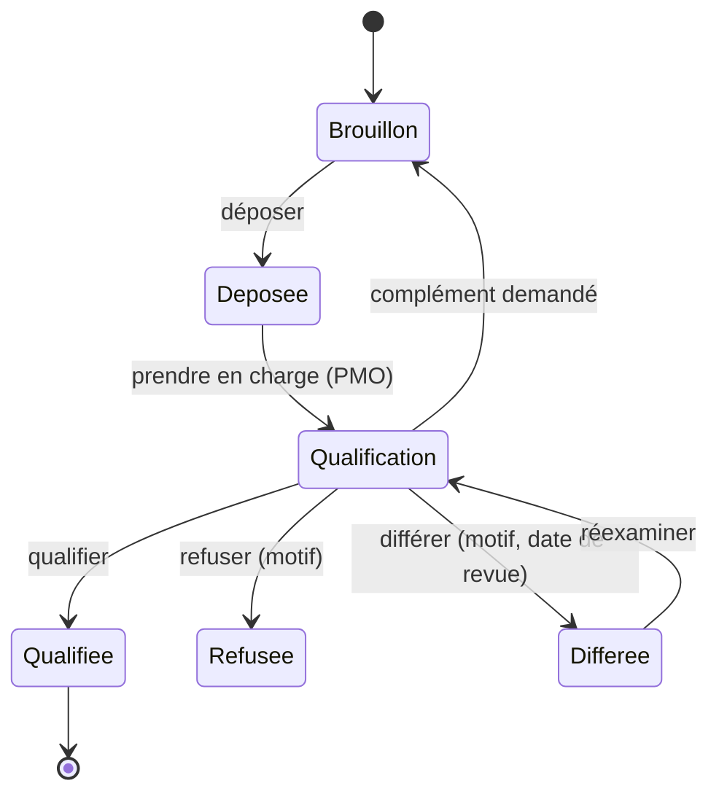

### A2. Évaluation et scoring [V3] (workflow 2)

| Élément | Contenu |
|---|---|
| Acteurs | Évaluateurs désignés, PMO |
| Étapes | Qualifiée → En évaluation → Évaluée |
| Données | `score` par critère du modèle en vigueur (`scoring_model` versionné) |
| Validations | Passage à « Évaluée » si la complétude est d'au moins 70 % ; sinon le score reste marqué « incomplet » |
| Calculs | Score normalisé pondéré (`04` § F2), recalculé à chaque note |
| Erreurs | Changement des poids pendant l'évaluation : les notes restent attachées à leur version, et le PMO choisit de réévaluer |

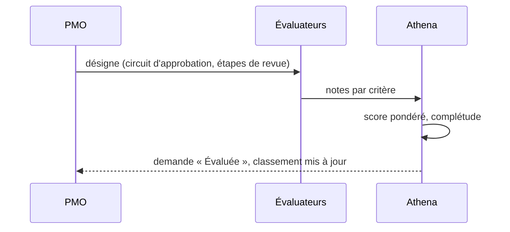

### A3. Sélection et intégration au portefeuille [V3] (workflow 3)

Le PMO prépare l'arbitrage (classement avec ligne de coupe), puis le comité tranche en revue de portefeuille (mécanisme M5). La sélection fait passer la demande à « Retenue » ; le projet n'existe qu'à l'étape A4. Décisions possibles : retenir, différer, refuser, chacune avec motif, enregistrée en `portfolio_decision`.

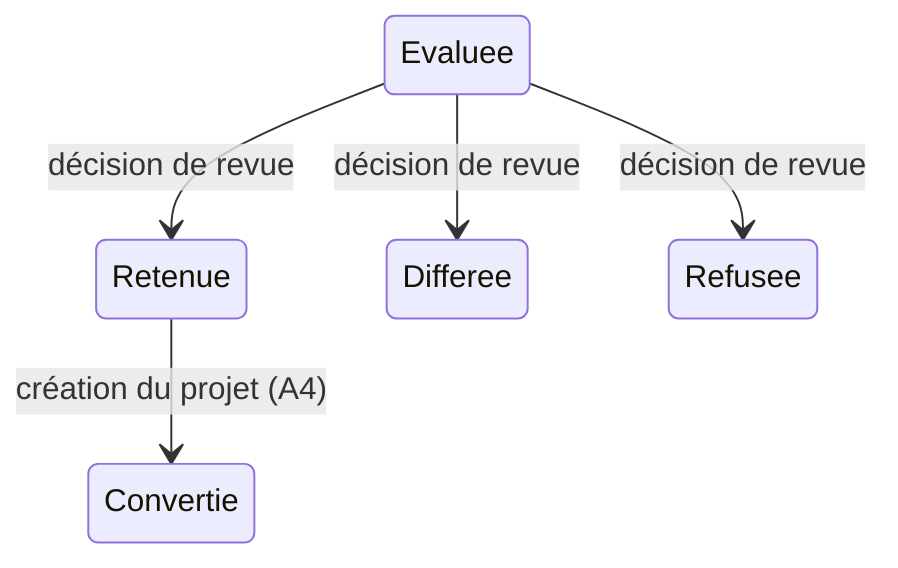

### A4. Création d'un projet et initialisation de son budget [V1 création, V2 budget] (workflow 4)

| Élément | Contenu |
|---|---|
| Acteurs | Administrateur ou PMO (création), chef de projet désigné |
| Étapes | Créer le projet depuis un gabarit (existant : `TemplateService.createProject`), état `approved` ; rattacher au portefeuille ; renseigner dates, sponsor et description (P1) ; en V2, saisir le budget initial (`budget_line kind = initial`) |
| Données | `project`, `portfolio_project`, `project_phase` (lignes créées depuis les phases du gabarit), `budget_line` |
| Validations | Clé unique ; gabarit et version existants ; devise du budget = devise du portefeuille |
| Notifications | Chef de projet désigné |
| Calculs | Aucun |
| Erreurs et reprise | Échec du dépôt Git du projet : la création est annulée en entier (comportement existant, transaction) |
| Niveaux | P (projet), F (rattachement) |

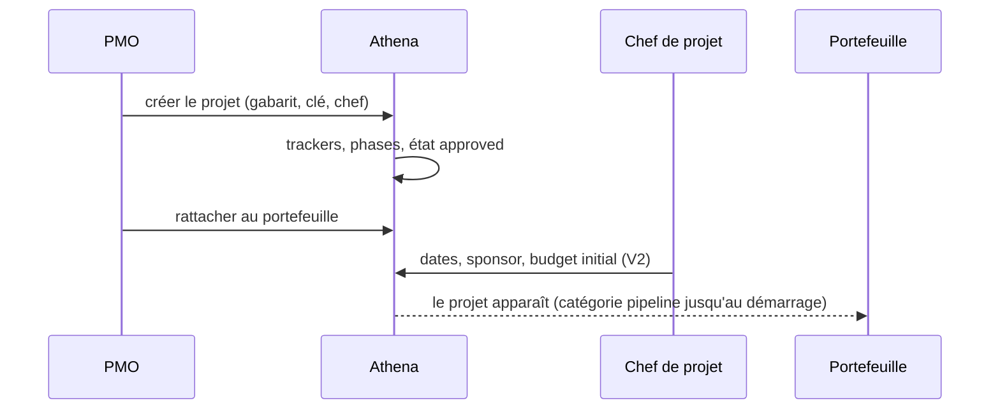

---

## B. Planifier

### B1. Estimation des ressources et contrôle de capacité [V2] (workflow 5)

| Élément | Contenu |
|---|---|
| Acteurs | Chef de projet (besoins), manager (affectations nominatives), PMO (arbitrage) |
| Étapes | Saisir les besoins par rôle et par période (`allocation` générique) ; contrôle automatique contre la capacité de l'équipe ; le manager nomme les personnes ; le PMO arbitre les conflits |
| Calculs | Capacité et charge par personne, rôle et période (job horaire, M4) ; signal de surcharge > 110 % (réglable) |
| Notifications | Manager quand un besoin vise son équipe ; PMO quand un besoin rend une période surchargée |
| Erreurs | Besoin sur une équipe sans capacité saisie : accepté, signalé « capacité inconnue » |
| Niveaux | P (besoin), F (consolidation), D (goulots) |

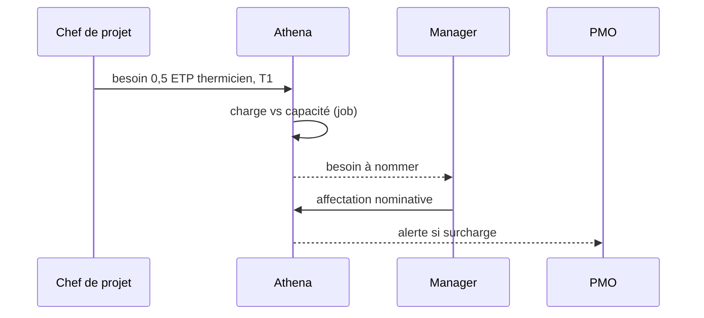

### B2. Plan macro et raccordement au planning détaillé [V1] (workflow 6)

- **Acteurs** : chef de projet.
- **Étapes** :
  1. Saisir `planned_start` et `planned_end`, ainsi que les dates des phases et des revues (`project_phase`).
  2. Planifier les tâches dans le Gantt existant.
  3. Athena compare la fin calculée (`computeSchedule`) à `planned_end` et aux dates de revue.
- **Règle** : le planning détaillé ne modifie jamais le plan macro. Un écart est **signalé** (marque sur la roadmap, alerte en V2) ; le chef de projet décide de replanifier ou d'ouvrir une demande de changement (D1).
- **Historique** : chaque changement de date prévue d'une revue s'ajoute à `project_phase_history`, ce qui alimente la courbe de tendance des jalons.

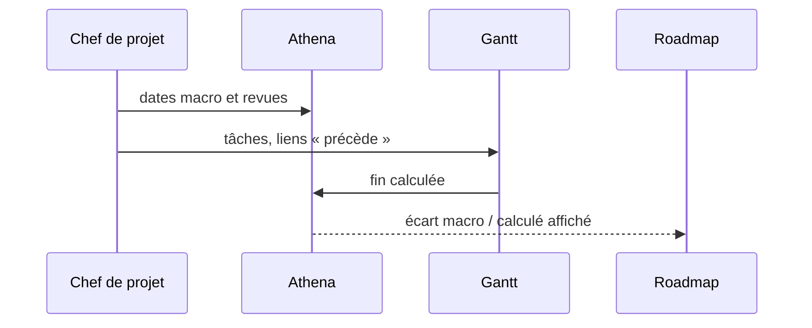

### B3. Découpage d'une initiative en projets, lots et tâches [V1 partiel] (workflow 7)

Avec un seul niveau de portefeuille (décision du 2026-11-15), une initiative **est** un projet. Le découpage se fait dans le projet, avec des tickets parents et le lien hiérarchique existant (le moteur calcule les dates des parentes, `schedule-engine.ts:13`), puis en versions. Une initiative multi-projets se représente par un portefeuille dédié. **Sans objet** au-delà en V1.

---

## C. Suivre

### C1. Suivi de l'avancement et consolidation au portefeuille [V1] (workflow 8)

| Élément | Contenu |
|---|---|
| Acteurs | Chef de projet (météo), PMO, direction |
| Étapes | Les équipes font avancer leurs tickets (existant) ; le chef de projet publie sa météo (`project_status_note`) au moins une fois par période ; Athena consolide à la lecture ; le job prend l'instantané hebdomadaire |
| Calculs | Santé calculée (`healthOf`), avancement, retards ; tendance contre le dernier instantané |
| Notifications | Chef de projet si aucune météo depuis N jours (réglable) |
| Permissions | Consolidation sous l'identité du lecteur (règle de visibilité) |
| Erreurs et reprise | Job d'instantané interrompu : la ligne `portfolio_snapshot` n'est validée qu'à la fin de sa transaction ; la relance refait l'instantané de la période |

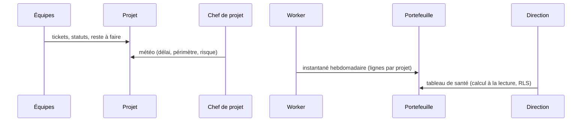

### C2. Détection et traitement d'un retard, d'une surcharge ou d'un dépassement [V2] (workflow 9)

- **Détection** : le job d'alertes (M4) évalue des règles réglables par l'organisation :
  - revue dépassée ;
  - projet critique sur deux instantanés ;
  - fin calculée au-delà de la fin prévue ;
  - surcharge de plus de 110 % ;
  - EAC au-delà du budget de plus de 5 %.
- **Alerte** : `portfolio_alert(rule, project, opened_at, owner, state open/acknowledged/resolved, cause_ref)`. Une seule alerte ouverte par règle et par objet (idempotence).
- **Traitement** :
  1. Le responsable prend en compte l'alerte.
  2. Il agit dans le projet : replanification, ticket d'action, ou demande de changement.
  3. L'alerte se résout **automatiquement** quand la condition disparaît, au passage suivant du job.
- **Notifications** : responsable de l'objet et PMO, puis résumé quotidien (`045`).

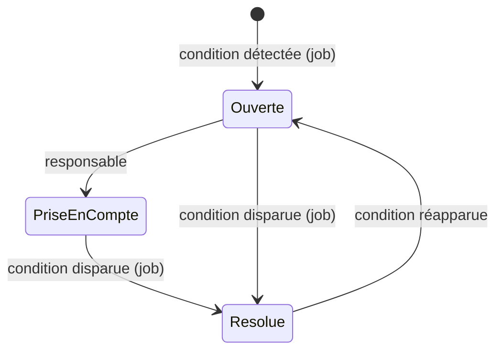

---

## D. Changer

### D1. Demande de changement de périmètre, de budget ou de délai [V2] (workflow 10)

| Élément | Contenu |
|---|---|
| Mécanisme | M1 : tracker CR existant (`templates/spatial.ts:35`, `defense.ts:23`), étendu par des champs d'impact chiffré (jours, montant, charge) |
| Étapes | Ouverte → Analysée → Soumise (au comité si l'impact dépasse un seuil du portefeuille) → Acceptée ou Rejetée → Appliquée |
| Données | À l'acceptation : `budget_line kind = avenant` (budget), nouvelles dates (`project_phase`, `planned_end`) ; chaque écriture référence la CR |
| Validations | Impact obligatoire avant Soumise ; décision par le comité si le seuil est dépassé, sinon par le chef de projet |
| Calculs | Effet cumulé des changements (historique et cascade du budget) |
| Erreurs | CR acceptée mais non appliquée : alerte « CR acceptée non appliquée » après N jours |

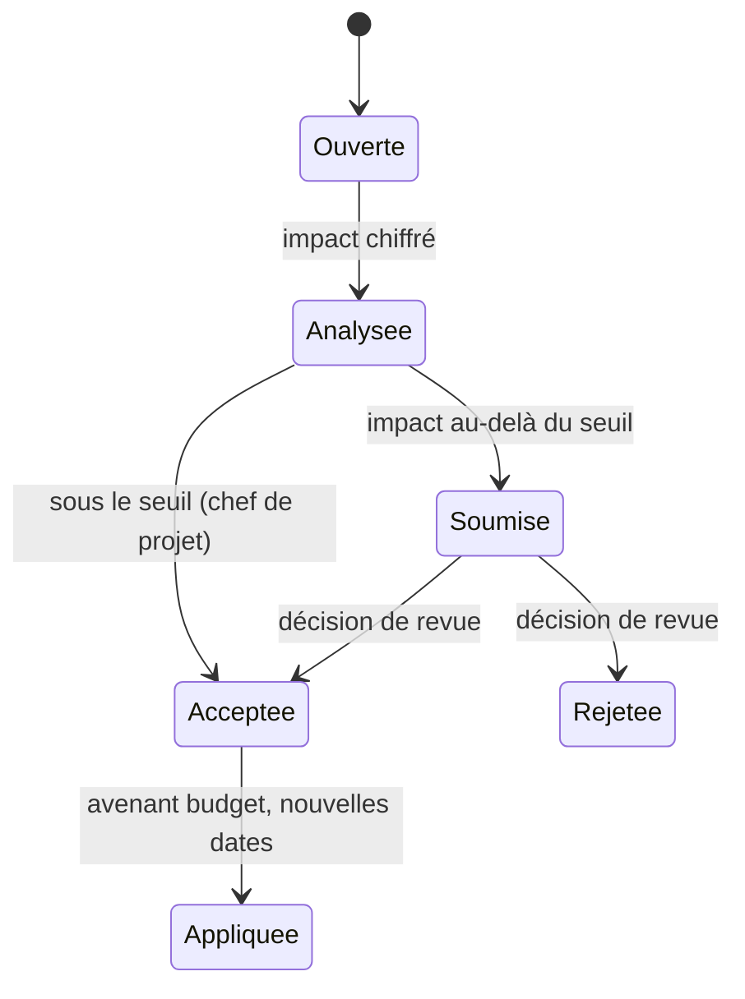

---

## E. Gouverner

### E1. Revue de portefeuille périodique [V1 sans décisions, V2 complète] (workflow 11)

| Élément | Contenu |
|---|---|
| Acteurs | PMO (préparation), chefs de projet (météo), direction (comité) |
| Étapes | Le PMO crée la revue (état brouillon) ; les chefs de projet mettent leur météo à jour ; à l'échéance de préparation, le PMO fige l'instantané « revue » ; le comité se tient sur le dossier imprimable ; la revue passe à « tenue », avec ses décisions (V2) |
| Données | `portfolio_review`, `portfolio_snapshot kind = review`, `portfolio_decision` |
| Notifications | Chefs de projet à la création (« météo attendue avant le … ») ; participants à la publication du dossier |
| Calculs | Comparaison avec l'instantané de la revue précédente |
| Erreurs | Instantané pris trop tôt : un nouvel instantané remplace celui de la revue tant qu'elle est en brouillon ; après « tenue », plus rien ne change |

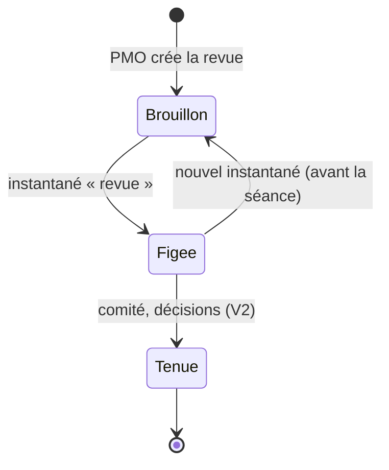

### E2. Passage de gate et décision de poursuite, pause, réorientation ou arrêt [V1 gate, V2 décisions] (workflow 12)

- **Gate (M3)** :
  1. Les critères automatiques se mettent à jour seuls.
  2. Le chef de projet confirme les critères manuels.
  3. La revue normative se tient.
  4. La décision `go`, `go_with_reserves` ou `no_go` est enregistrée dans `project_phase` par le chef de projet. Si le gabarit l'exige, c'est l'assurance qualité qui décide, via le circuit d'approbation existant (`041`).
- Un `go` fait avancer la phase ; `go_with_reserves` crée des tickets d'action liés ; `no_go` laisse la phase en place et ouvre une alerte.
- **Décision de portefeuille** (M5, V2) : poursuivre, suspendre, réorienter ou arrêter, enregistrée en revue. Elle **propose** la transition de cycle de vie (`on_hold`, `cancelled`). Le chef de projet ou l'administrateur l'applique (M2), et l'alerte « décision non appliquée » couvre l'oubli.

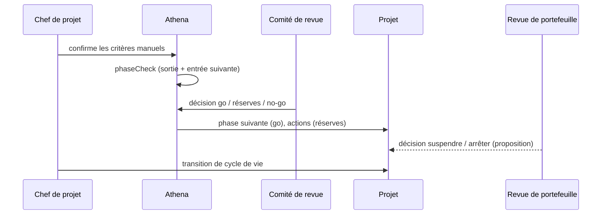

### E3. Clôture et capitalisation [V1 clôture, V2 bilan] (workflow 13)

- **Étapes** : passage à `closing` ; vérifications (tickets ouverts, RID, actions, alertes) ; bilan (ticket « Retour d'expérience » du projet de pilotage, lié au projet) ; passage à `completed` par le PMO ; puis `archived`.
- **Validations** : `completed` est refusé s'il reste des tickets non terminés, sauf transfert explicite à un autre projet.
- **Calculs** : écarts finaux contre la baseline initiale (délai ; budget en V2) inscrits dans l'instantané de clôture.
- **Niveaux** : P (clôture), F (sortie du tableau de santé, conservation dans les instantanés).

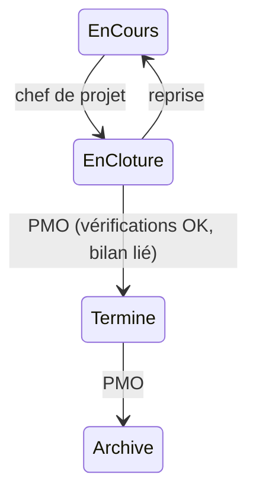
