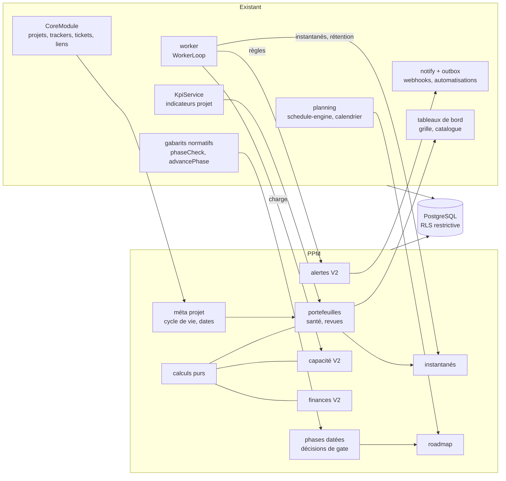

# PPM Athena — 06. Architecture

## Résumé

1. **Évolution minimale** : un nouveau dossier `apps/api/src/ppm/` (services, contrôleurs, calculs purs), branché dans le module NestJS existant. Côté web, des pages sous `/portefeuilles` et un composant `<Chart>` dans `@athena/ui`.
2. **Aucune nouvelle infrastructure** : PostgreSQL (RLS), l'outbox et les boucles du worker existantes suffisent. La seule dépendance ajoutée est Apache ECharts, côté web, chargée à la demande.
3. **Permissions** : toute table PPM porte une politique restrictive, et tout agrégat se calcule sous l'identité du lecteur. Un test d'architecture et des tests « lecteur restreint contre lecteur complet » le garantissent.
4. **Calculs** : des fonctions pures et testées (santé, capacité, EAC, score, propagation), sur le modèle de `schedule-engine.ts`.
5. **Activation progressive** : un interrupteur par organisation (`organization_feature`). Il n'existe pas aujourd'hui : c'est le plus petit ajout possible.
6. **Migrations** : le moteur ne fait qu'avancer, avec une somme de contrôle (`apps/api/src/db/migrate.ts:12-28`). « Réversible » veut donc dire migration additive, plus une migration compensatoire écrite et testée pour chaque changement destructeur.
7. **Décision attendue** : garder le PPM dans le module `CoreModule` (recommandé à court terme) ou en extraire un `PpmModule` (§ 1).

---

## 1. Modules

**Observé** : l'API a un seul module métier, `CoreModule` (`apps/api/src/core/core.module.ts:101`, 276 lignes), qui déclare 30 contrôleurs et leurs services par fabriques (`useFactory`). `AppModule` n'importe que lui (`app.module.ts:19`).

**Recommandation** : un dossier `apps/api/src/ppm/` avec son propre `PpmModule`, importé par `AppModule`. Il réutilise les fournisseurs exportés par `CoreModule` (`Db`, `KpiService`, `OrgResolver`, `MemberService`). Il faut pour cela ajouter ces fournisseurs aux `exports` de `CoreModule` (aujourd'hui `FieldTypeRegistry` et `PG_POOL`, `core.module.ts:274`). Raison : le PPM grossira (capacité, finances), et `core.module.ts` est déjà le fichier le plus couplé de l'API. Impact : un changement de 3 lignes dans `CoreModule`. Test : les tests HTTP existants (`core-http.test.ts`) et un test de démarrage du module.

| Composant | Existant concerné | Rôle |
|---|---|---|
| `ppm/portfolio.*` | Déplacé depuis `core/portfolio.service.ts`, `core/portfolio.controller.ts` (lot 16) | Portefeuilles, santé, rattachement |
| `ppm/project-meta.*` | `core/tracker.service.ts` (projet) | Dates, sponsor, cycle de vie configurable (P1) |
| `ppm/phase.*` | `core/template-upgrade.service.ts` (phaseCheck, advancePhase) | Phases datées, décisions de gate, historique (P6) |
| `ppm/status-note.*` | — | Météo du projet |
| `ppm/snapshot.*` | `workers/tasks.ts` | Instantanés, revues, rétention |
| `ppm/roadmap.*` | `planning/schedule-engine.ts`, `planning/schedule.service.ts` | Roadmap multi-projets, propagation (V2) |
| `ppm/capacity.*` | `core/work-calendar.ts`, `core/team.service.ts` | Disponibilité, absences, allocations, charge (V2) |
| `ppm/finance.*` | `import/` (modèle d'import idempotent) | Budget, réels, import CSV, EAC (V2) |
| `ppm/alert.*` | `notify/`, `workers/tasks.ts` | Règles et alertes (V2) |
| `ppm/calc/*.ts` | — | Fonctions pures : santé, tendance, capacité, conversion semaine/mois, EAC, score |
| Web `pages/portfolio/*` | `PortfoliosPage.tsx`, `TeamLoadPage.tsx` | Santé, roadmap, revues, gates, capacité, finances |
| `@athena/ui` `<Chart>` | `packages/ui/src/components.tsx` | Enveloppe ECharts : thème depuis les jetons, SVG, ARIA, motifs, vue tableau |

## 2. API, commandes et événements

Conventions existantes : REST sous `/v1`, corps validés par Zod et décrits dans l'OpenAPI (`@BodySchema`, `apps/api/src/openapi/`), droits par `@Roles` puis contrôle fin dans le service.

| Ressource | Méthodes | Version |
|---|---|---|
| `/v1/projects/:p/meta` | GET, PATCH (dates, sponsor, description, granularité) | V1 |
| `/v1/projects/:p/lifecycle` | GET (état, transitions permises), POST `transition` (cible, motif) | V1 |
| `/v1/admin/lifecycle-states` | GET, PUT (états et transitions de l'organisation) | V1 |
| `/v1/projects/:p/phases` | GET ; PATCH `:phase` (dates) ; POST `:phase/decision` | V1 |
| `/v1/projects/:p/status-notes` | GET, POST | V1 |
| `/v1/portfolios/:k/health` | GET (tableau de santé, filtres, `format=csv`) | V1 |
| `/v1/portfolios/:k/roadmap` | GET (`from`, `to`, `baseline`) | V1 |
| `/v1/portfolios/:k/snapshots` | GET, POST ; GET `:id` ; GET `compare?a=&b=` | V1 |
| `/v1/portfolios/:k/reviews` | GET, POST, PATCH | V1 |
| `/v1/portfolios/:k/gates`, `/risks` | GET | V1 |
| `/v1/admin/ppm-settings` | GET, PUT (durée de la journée, rétention, fréquence, seuils) | V1 et V2 |
| `/v1/capacity/*`, `/v1/projects/:p/allocations`, `/v1/me/worklog` | GET, POST, PATCH, DELETE | V2 |
| `/v1/projects/:p/budget/*`, `/v1/finance/imports` | GET, POST | V2 |
| `/v1/portfolios/:k/alerts`, `/decisions` | GET, POST, PATCH | V2 |

**Événements** dans l'outbox (`003`), consommés par les webhooks, les automatisations et les plugins existants :
- `project.lifecycle.changed`, `project.phase.decided`, `project.status_note.created` ;
- `portfolio.snapshot.taken`, `portfolio.review.held`, `portfolio.decision.recorded` ;
- en V2 : `alert.opened`, `alert.resolved`, `budget.changed`, `allocation.changed`.

Un événement ne transporte que des clés et des identifiants, jamais de valeur de champ : c'est la règle de `044_notifications.sql:4`.

## 3. Jobs

Ce sont des boucles `WorkerLoop` (`apps/api/src/workers/loop.ts:22`), avec un recul exponentiel déjà en place (`loop.ts:68`) et un état de santé exposé (`tasks.ts:98`).

| Job | Fréquence | Contenu | Reprise après erreur |
|---|---|---|---|
| `instantanes` | Horaire ; agit si la période est échue | Pour chaque portefeuille dont l'instantané de la période manque : une transaction par portefeuille, lignes par projet calculées en contexte système | Idempotent : contrainte unique (portefeuille, période, `weekly`) ; une transaction échouée est refaite au passage suivant |
| `retention` | Quotidienne | Purge des instantanés hebdomadaires au-delà de la rétention ; audit de chaque purge | Idempotent |
| `capacite` [V2] | Horaire, et sur événement `allocation.changed` | Charge et capacité par personne et période, dans une table matérialisée `capacity_cell` | Recalcul complet d'une personne par transaction |
| `alertes` [V2] | Toutes les 15 min | Évalue les règles ; ouvre ou résout les alertes (une par règle et par objet) | Idempotent par contrainte unique |
| `indicateurs` [palier 2] | Sur événement de ticket, et toutes les 15 min | Matérialise par projet les indicateurs de `KpiService` (`project_kpi`) | Recalcul du projet ; lecture de secours à la volée si la ligne date de plus de 30 min |

**Contexte système et visibilité** : un job écrit en contexte système (`db.tx(..., { system: true })`, `apps/api/src/core/db.ts:11`), mais **uniquement des lignes par projet**. Leur lecture repasse par la RLS (`03` § 3.3).

## 4. Cache, index, matérialisation (palier 2 confirmé)

- **Palier 1, et début du palier 2** : aucun cache. `PortfolioService.summary` met déjà en cache les indicateurs d'un projet pendant une requête (`portfolio.service.ts`, paramètre `cache`).
- **Bascule** vers la table `project_kpi` quand la mesure le justifie : P95 du tableau de santé au-delà de 2 s pour 50 projets. La mesure se fait aux tests de charge de fin de projet (votre décision) ; d'ici là, le contrat d'API ne change pas.
- **Index à ajouter** :
  - `portfolio_project(project_id)` ;
  - `project_phase(project_id, phase)` ;
  - `portfolio_snapshot(portfolio_id, taken_at desc)` ;
  - `portfolio_snapshot_line(snapshot_id)` ;
  - en V2 : `allocation(project_id, from)`, `allocation(subject, from)`, `worklog(subject, day)`, `actual_cost(project_id, period)`.
- **Recherche des tickets en retard ou bloqués** : `KpiService` passe par l'ATQL (quatre recherches par projet, `kpi.service.ts:43-60`), qui a déjà un délai maximal par requête (`search.service.ts:150`). La matérialisation supprime ce coût au palier 2.

## 5. Permissions

| Règle | Mise en œuvre | Test |
|---|---|---|
| Rôles | `athena-pmo` (fait), `athena-finance` (V2) ; `withUserRole` (`auth.guard.ts:26`) | `auth.test.ts` |
| Écriture | `@Roles` puis contrôle fin (chef désigné : `MemberService.requireManager`) | Tests par route |
| Visibilité des lignes | Politique restrictive `acl_allows(project_id, null)` sur chaque table PPM à `project_id`, `acl_artifact_ok` pour `worklog` | **Test d'architecture** : toute migration créant une table à `project_id` déclare `acl_read` (analyse des fichiers SQL) |
| Agrégats | Calcul dans `db.tx` sans `system: true` | Tests « lecteur restreint contre lecteur complet » pour chaque agrégat (modèle : `team-portfolio.test.ts`) |
| Données sensibles | Taux des ressources et motif des absences : vues SQL filtrées par rôle, jamais exposées par les agrégats | Test : un rôle non finance n'obtient aucun taux, ni par l'API ni par l'export |

## 6. Audit et traçabilité

Chaque écriture appelle `audit()` (`core/tracker.service.ts:379-387`) avec une action nommée `ppm.*`. Les tables d'historique sont en ajout seul et protégées par `GRANT` (pas d'`UPDATE` ni de `DELETE` pour `athena_app`) :
- `project_lifecycle_history` ;
- `project_phase_history` ;
- `project_status_note` ;
- `budget_line` ;
- `portfolio_decision`.

Les instantanés sont immuables ; seule la purge de rétention les supprime, et elle est auditée.

## 7. Migrations et activation

- **Numérotation** : la prochaine migration réelle est la 065.
- **Additives** : colonnes nullables et tables nouvelles ; les données existantes restent valides (par exemple `lifecycle_state` par défaut `in_progress`).
- **Destructrices** : rare ; par exemple, la conversion de `remaining` en minutes. Chacune a une migration compensatoire écrite, testée sur une copie, et une sauvegarde préalable documentée dans `docs/admin`.
- **Activation** : table `organization_feature(organization_id, key, enabled)`, avec les clés `ppm.roadmap`, `ppm.capacity`, `ppm.finance` et `ppm.demand`. Le rail et les routes respectent l'interrupteur, comme les modules de projet (`project-overview.service.ts:17-29`).

## 8. Stratégie de test

| Niveau | Contenu | Outil existant |
|---|---|---|
| Unitaire | Fonctions pures : santé et tendance, conversion semaine/mois au prorata des jours ouvrés, capacité (temps partiel, demi-journée, jours fériés), durée en heures et minutes, EAC, score et normalisation, propagation de retard | Vitest, sur le modèle de `schedule-engine.test.ts` |
| Intégration | Services sur PostgreSQL réel, RLS active | `testing/harness.ts` (`createTestDb`) |
| Permissions | Pour chaque agrégat : un lecteur restreint par une liste d'ayants droit ne voit aucune trace du projet ; test d'architecture des politiques | `runAs` (`core/request-context.ts`) |
| Concordance | Écart à la baseline de la roadmap = écart du Gantt du projet ; totaux du tableau de santé = somme des indicateurs de projet | Intégration |
| Interface | Pages par rôle, vue tableau de chaque graphique, garde-fous existants (`guards.test.ts` : confirmations, aucun style en ligne) | Testing Library, axe |
| e2e | Parcours PMO (revue) et direction (santé, roadmap) | Playwright (`e2e/`) |
| Charge | Tableau de santé, roadmap et capacité au palier 2 : 300 projets, 500 000 tickets, 1 000 personnes | `apps/api/src/perf/`, **en fin de projet** (votre décision), pour dimensionner le serveur |

## 9. Diagramme

