# PPM Athena — 07. Plan de livraison, risques et KPI

## Résumé

1. **Dix incréments**, de I0 à I9. Chacun livre une valeur visible et tient en 4 à 10 tâches d'une session (règle de `CLAUDE.md` : environ 5 fichiers et 400 lignes par tâche).
2. **V1 = I0 à I3** : prérequis du projet, santé, roadmap, revues. **V2 = I4 à I7** : capacité, dépendances, finances, gouvernance. **V3 = I8**. **I9** = tests de charge et dimensionnement du serveur, en fin de projet (votre décision).
3. Valeur au plus tôt : à la fin d'I1, la direction a un tableau de santé fiable, sans recopie, exportable et imprimable.
4. **Point de règle à trancher d'abord** : `CLAUDE.md` interdit d'ouvrir un lot tant que les écarts du précédent ne sont pas comblés. Or les e2e, les références visuelles et l'axe en navigateur des lots 13 et 16 n'ont pas été exécutés. Je recommande de les rejouer avant I0, c'est-à-dire avant le premier lot PPM.
5. **Décisions attendues** : les sept décisions du § 3.

---

## 1. Incréments

### I0 — Prérequis de niveau projet [V1]
- **Objectif métier** : un projet porte enfin ses dates, son état de vie, son sponsor et ses phases datées. C'est visible dès ce stade dans la fiche du projet.
- **Contenu** :
  - P1 : méta du projet et cycle de vie configurable (treize états livrés, transitions, historique, écran d'administration) ;
  - P6 : phases datées, décisions de gate, historique des dates ;
  - P5 : rôles sémantiques probabilité et impact ;
  - interrupteur `organization_feature` ;
  - réglages PPM de l'organisation (durée de la journée en heures et minutes, rétention, fréquence) ;
  - extraction de `PpmModule` ;
  - intégration d'ECharts et vérification de H-V1 (CSP) et H-V2 (poids).
- **Visualisations** : frise des stage gates étendue (dates et décisions).
- **Prérequis** : écarts des lots 13 et 16 levés ou acceptés (§ 3, D1).
- **Recette mesurable** :
  - un projet existant reste valide après migration (état `in_progress`) ;
  - une transition non permise est refusée ;
  - toute date de revue modifiée apparaît dans l'historique avec son auteur ;
  - un graphique ECharts s'affiche sous la CSP de production ;
  - le chunk ECharts pèse moins de 200 Ko compressés.
- **Risques** : migration des données existantes ; CSP d'ECharts. **Estimation** : L (environ 9 tâches).

### I1 — Santé du portefeuille [V1]
- **Objectif métier** : la direction et le PMO voient en une page l'état réel de chaque portefeuille, sans recopie.
- **Contenu** :
  - météo du projet ;
  - tableau de santé enrichi : calculé, déclaré, forcé, dates, phase, prochaine revue ;
  - tuiles de la vue direction ;
  - export CSV avec marquage ;
  - fiche projet d'une page (impression) ;
  - portée de tableau de bord `portfolio:<clé>` et carte « santé » ;
  - tests de visibilité des agrégats et test d'architecture des politiques.
- **Visualisations** : tuiles, tableau de santé, fiche projet.
- **Recette mesurable** :
  - tableau de 50 projets en moins de 2 s en recette ;
  - zéro trace d'un projet masqué (test automatisé) ;
  - l'export CSV contient exactement les lignes de la vue ;
  - la fiche d'une page s'imprime sur une page A4 par projet.
- **Risques** : adoption de la météo par les chefs de projet. **Estimation** : M (environ 7 tâches).

### I2 — Roadmap consolidée [V1]
- **Objectif métier** : voir où en est chaque projet dans son cycle normatif et dans le temps, réel contre baseline.
- **Contenu** :
  - roadmap multi-projets en lecture (couloirs, chevrons de phase, losanges de revue, versions) ;
  - barres fantômes de baseline ;
  - vue jalons seule ;
  - gabarit « Projet spatial (ECSS-M-ST-10) » et gabarit DGA (annexe), avec un critère filtrable sur deux champs.
- **Visualisations** : timeline à couloirs, barres fantômes, vue jalons.
- **Recette mesurable** :
  - écart à la baseline identique au Gantt du projet (test de concordance) ;
  - chaque élément mène à son objet ;
  - un projet créé depuis le gabarit ECSS a ses 7 phases et ses 13 revues.
- **Risques** : lisibilité au-delà de 50 couloirs (regroupement replié). **Estimation** : L (environ 8 tâches).

### I3 — Revues de portefeuille [V1]
- **Objectif métier** : préparer et tenir une revue de portefeuille en une heure au lieu d'une journée.
- **Contenu** :
  - instantanés (job, rétention réglable) ;
  - comparaison entre deux instantanés ;
  - revue de portefeuille et dossier imprimable ;
  - courbe de tendance des jalons (MTA) ;
  - tableau de passage des gates ;
  - matrice des risques ;
  - suivi des actions ;
  - mini-courbes dans le tableau de santé.
- **Visualisations** : comparaison d'instantanés, dossier de revue, MTA, tableau de passage, matrice des risques, suivi des actions, mini-courbes.
- **Recette mesurable** :
  - un instantané rejoué deux fois pour la même période n'en crée qu'un ;
  - la purge respecte la rétention réglée ;
  - le dossier de revue reprend l'instantané figé et non les données du jour ;
  - la matrice ne compte aucun risque d'un tracker masqué.
- **Risques** : volume des instantanés (palier 2 : 300 lignes par semaine et par portefeuille, négligeable). **Estimation** : L (environ 9 tâches).

### I4 — Capacité, première partie [V2]
- **Contenu** :
  - durée de la journée par personne ;
  - `remaining` en minutes, avec la migration des valeurs existantes ;
  - disponibilité et absences ;
  - allocations nominatives et par rôle ;
  - job `capacite` ;
  - granularité semaine ou mois par projet et par portefeuille.
- **Visualisations** : carte de chaleur, histogramme empilé avec ligne de capacité, besoin contre capacité, liste des goulots.
- **Recette** : capacité calculée égale au calcul de référence (temps partiel, jour férié, demi-journée) ; même total en semaines et en mois ; un manager ne voit que ses équipes. **Estimation** : XL (environ 10 tâches).

### I5 — Temps passé et dépendances entre projets [V2]
- **Contenu** :
  - worklog (saisie en heures et minutes, par ticket) ;
  - planifié contre consommé ;
  - planning d'affectation par personne ;
  - P3 : lien « précède » entre projets ;
  - propagation d'un retard en lecture.
- **Visualisations** : planifié contre consommé, planning d'affectation, graphe et matrice des dépendances, propagation.
- **Recette** : un lien inter-projets exige de voir les deux projets ; la propagation n'écrit rien. **Estimation** : L (environ 8 tâches).

### I6 — Finances [V2]
- **Contenu** :
  - rôle `athena-finance` ;
  - catégories de dépense, lignes de budget (initial, avenant, arbitrage), engagements, réels (saisie manuelle et import CSV idempotent), prévisions, EAC ;
  - taux des ressources et coût du temps passé ;
  - alertes de dépassement.
- **Visualisations** : courbe en S, barres budget, réel et EAC, graphique à puces, cascade, répartition et treemap par catégorie, carte de chaleur des écarts, tableau des écarts à mini-courbes.
- **Recette** : import de 1 000 lignes dont 3 erronées, avec 997 enregistrées et 3 rapportées ; aucun taux lisible hors finance et administration. **Estimation** : L (environ 9 tâches).

### I7 — Gouvernance V2 [V2]
- **Contenu** : décisions de portefeuille ; centre d'alertes ; demandes de changement chiffrées et leur application ; projet de pilotage par portefeuille (risques transverses) ; clôture et retour d'expérience.
- **Visualisations** : centre d'alertes, journal des décisions, exposition aux risques, trajectoire d'un risque, historique des changements de périmètre.
- **Recette** : une alerte s'ouvre et se résout seule ; une décision « suspendre » propose la transition sans l'appliquer. **Estimation** : L (environ 8 tâches).

### I8 — Demandes, priorisation, scénarios [V3]
- **Contenu** : tracker `request` et conversion en projet ; modèle de scoring versionné ; scénarios what-if (planning, capacité, budget) ; valeur acquise (CPI, SPI).
- **Visualisations** : Kanban, entonnoir, histogramme des délais, radar et barres par critère, comparatif de demandes, entrées et sorties, bulles, ligne de coupe, contributions au score, Sankey, sensibilité, comparateur de scénarios, superposition what-if, avant/après capacité, quadrant CPI/SPI, matrice de compétences.
- **Estimation** : XL (environ 12 tâches, à redécouper en I8a et I8b).

### I9 — Charge et dimensionnement du serveur [fin de projet]
- **Contenu** : jeu de données du palier 2 (300 projets, 500 000 tickets, 1 000 personnes) ; mesures P50 et P95 des vues de portefeuille, des jobs et des imports ; décision de matérialiser `project_kpi` ; caractéristiques du serveur (CPU, mémoire, PostgreSQL).
- **Recette** : rapport de dimensionnement avec les mesures et la configuration recommandée. **Estimation** : M.

```mermaid
gantt
  title Ordre des incréments (durées indicatives en tâches d'une session)
  dateFormat X
  axisFormat %s
  section V1
  Écarts lots 13 et 16 :e0, 0, 3
  I0 Prérequis projet :i0, after e0, 9
  I1 Santé :i1, after i0, 7
  I2 Roadmap :i2, after i1, 8
  I3 Revues :i3, after i2, 9
  section V2
  I4 Capacité 1 :i4, after i3, 10
  I5 Temps et dépendances :i5, after i4, 8
  I6 Finances :i6, after i5, 9
  I7 Gouvernance :i7, after i6, 8
  section V3 et fin
  I8 Demandes, scoring, scénarios :i8, after i7, 12
  I9 Charge et dimensionnement :i9, after i8, 4
```

## 2. Risques

| Risque | Probabilité | Impact | Traitement |
|---|---|---|---|
| Duplication et désynchronisation entre niveaux | Moyenne | Fort | Règle « le portefeuille référence, ne copie pas » ; seuls les instantanés figent des valeurs, et c'est voulu ; revue de code sur chaque table PPM |
| Performance des agrégations | Moyenne au palier 2 | Moyen | Calcul à la demande mis en cache par requête ; matérialisation prête (`project_kpi`) ; décision à I9 sur mesure |
| Fuite d'information par les agrégats | Faible (après `064`) | Très fort (défense) | Politiques restrictives sur toute table PPM ; calcul sous l'identité du lecteur ; test d'architecture et tests « lecteur restreint » à chaque incrément |
| Qualité des données historiques | Forte | Moyen | Projets sans dates ni météo signalés (« non renseigné ») au lieu d'être estimés ; tendance seulement à partir du deuxième instantané ; `remaining` migré après confirmation de son unité, projet par projet |
| Complexité des règles de priorisation | Moyenne | Moyen | Repoussée en V3 ; score simple et explicable (barres de contribution) ; versionnage du modèle |
| Adoption | Moyenne | Fort | Météo en moins d'une minute ; dossier de revue généré, ce qui supprime la recopie, premier bénéfice tangible ; mesure d'usage (KPI 6) |
| Écarts de lots non levés | Forte | Moyen | Rejouer e2e, visuel et axe des lots 13 et 16 avant I0 (D1) |
| ECharts sous CSP | Faible à moyenne | Moyen | Vérification en I0 (H-V1) ; repli sur le rendu canvas pour ce seul composant |

## 3. Décisions à prendre avant le développement

| # | Décision | Options | Recommandation |
|---|---|---|---|
| D1 | Écarts des lots 13 et 16 (e2e, visuel, axe) | (a) les rejouer avant I0 ; (b) les accepter explicitement | (a) : la règle de `CLAUDE.md`, et un PPM bâti sur une interface non vérifiée hériterait des écarts |
| D2 | Numérotation des lots | Un lot par incrément (lots 17 à 26) ou un lot par version | Un lot par incrément : arrêt et compte rendu à chaque valeur livrée |
| D3 | `PpmModule` séparé | (a) module séparé ; (b) rester dans `CoreModule` | (a) : coût de 3 lignes, et `CoreModule` est déjà le point le plus couplé |
| D4 | Maître des dates macro | (a) `planned_end` saisi, l'écart avec le calculé étant signalé ; (b) `planned_end` toujours calculé | (a) : une date d'engagement contractuel ne doit pas bouger seule |
| D5 | Unité de `remaining` pour les projets existants | (a) le chef de projet confirme l'unité, puis on migre ; (b) heures pour tous | (a) : les données de démonstration mêlent peut-être points et heures |
| D6 | Projet de pilotage pour les risques transverses et les demandes | (a) un par portefeuille ; (b) un par organisation | (a) : les droits suivent le portefeuille |
| D7 | Gabarits ECSS et DGA | (a) les livrer en I2 tels que proposés dans l'annexe, à ajuster ensuite ; (b) attendre votre tailoring et l'IM 1618 | (a) : l'héritage de gabarits permet d'ajuster sans migration |

### Décisions de l'utilisateur (2026-11-15)

| # | Décision |
|---|---|
| D1 | En attente : rappel des écarts demandé |
| D2 | Un lot par incrément (lots 17 à 26) |
| D3 | `PpmModule` séparé |
| D4 | `planned_end` saisi ; l'écart avec la fin calculée est signalé |
| D5 | L'unité de `remaining` est confirmée par chaque chef de projet avant la migration |
| D6 | **Plusieurs projets de pilotage par portefeuille** (par exemple un pour les risques transverses, un pour les demandes, un par programme). Un projet est déclaré « de pilotage » par un rôle de rattachement (`portfolio_project.kind = pilot`, avec un objet libre) ; il reste un projet ordinaire et sort du tableau de santé et de la roadmap |
| D7 | Gabarits ECSS et DGA livrés en I2 tels que proposés, ajustés ensuite par héritage |

## 4. KPI de succès

| KPI | Cible | Méthode de mesure |
|---|---|---|
| Temps de préparation d'une revue de portefeuille | Moins de 1 h (contre une journée estimée aujourd'hui, à mesurer avant I1) | Écart entre la création de la revue et son instantané « revue », complété d'une déclaration du PMO lors des deux premières revues |
| Part des projets lancés sans capacité disponible | Moins de 10 % (V2) | Projets passés à `starting` alors que leurs allocations rendaient une période surchargée : croisement de `project_lifecycle_history` et de `capacity_cell` |
| Délai de traitement des demandes | Médiane de moins de 30 jours (V3) | Durée de dépôt à décision, tirée des révisions des tickets `request` |
| Part des projets rattachés à un objectif | Plus de 90 % (V3) | Projets actifs liés à au moins un objectif stratégique / projets actifs |
| Exactitude des agrégations | 100 % | Test automatisé : totaux de portefeuille = somme des indicateurs des projets visibles, recalculés indépendamment ; écart à la baseline = écart du Gantt |
| Usage réel des tableaux de bord | 80 % des directeurs et PMO au moins une fois par semaine | Journal d'accès aux routes `/v1/portfolios/*` par rôle (agrégé, sans contenu), à ajouter en I1 |
| Fraîcheur de la météo | 90 % des projets actifs avec une météo de moins de 30 jours | Requête sur `project_status_note` |
