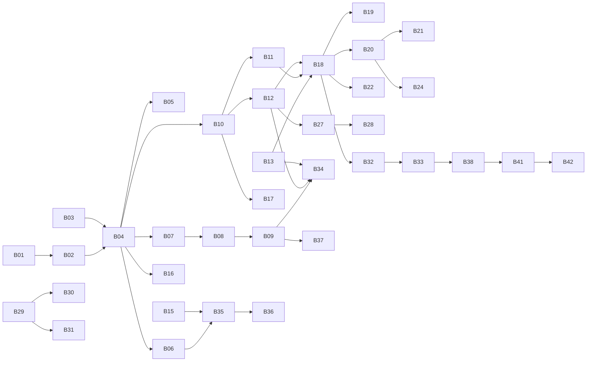

# PPM Athena — 08. Backlog

## Résumé

1. **42 éléments, dans l'ordre de réalisation.**
   - Les levées d'écarts (B01 à B03), puis I0 (B04 à B16) et I1 (B17 à B26) sont détaillés : description, critères d'acceptation, estimation, dépendances.
   - Les incréments I2 à I9 restent au niveau epic (B27 à B42).
2. Les **tâches de vérification** issues des hypothèses sont marquées « V » : B07, B08, B15 et B16 dans le backlog, B39 et B40 pour les sources normatives.
3. Estimation : **S** ≤ 1 tâche d'une session, **M** = 2 tâches, **L** = 3 ou 4 tâches, **XL** = 5 tâches ou plus.
4. Composants : BE (backend), FE (frontend), DB (base), API, CALC (moteur de calcul), REP (reporting), PERM (permissions), NOTIF (notifications).
5. **Décision attendue** : l'ordre et la priorité, et D1 (écarts des lots 13 et 16) du plan de livraison.

---

## Avant I0 : écarts des lots précédents (règle de changement de lot)

| ID | Titre | Description | Critères d'acceptation | Priorité | Est. | Dép. | Composant |
|---|---|---|---|---|---|---|---|
| B01 | Rejouer les e2e (lots 13 et 16) | Suite Playwright complète, serveurs 3000 et 3001 arrêtés, sources gelées pendant la suite | Toute la suite est verte, ou chaque échec est corrigé ou accepté explicitement | Must | M | — | e2e |
| B02 | Références visuelles et axe en navigateur | `pnpm visuel:reference` après relecture ; axe sur les 11 thèmes × 2 modes, pages `/charge` et `/portefeuilles` comprises | Captures relues et validées par l'utilisateur ; zéro violation axe | Must | M | B01 | FE |
| B03 | Corriger les 4 échecs de la suite web | Dates ISO tronquées ; sélection d'une tâche du planning (3 tests) | Suite web verte | Must | S | — | FE |

## I0 — Prérequis de niveau projet

| ID | Titre | Description | Critères d'acceptation | Priorité | Est. | Dép. | Composant |
|---|---|---|---|---|---|---|---|
| B04 | Extraire `PpmModule` | Dossier `apps/api/src/ppm/`, déplacement du portefeuille et des équipes (lot 16), exports de `CoreModule` | Routes et tests du lot 16 inchangés et verts ; OpenAPI identique | Must | S | B01 | BE |
| B05 | Interrupteurs de fonctionnalité | Table `organization_feature`, API d'administration, prise en compte par le rail et les routes | Désactiver `ppm.roadmap` masque l'entrée du rail et renvoie 404 sur ses routes | Must | S | B04 | DB, API, FE |
| B06 | Réglages PPM de l'organisation | `organization_ppm_settings` : durée de la journée en minutes (saisie et affichage en heures et minutes), rétention et fréquence des instantanés, seuils ; Administration › PPM | « 7 h 48 », « 7 h 00 » et « 8 h 00 » se saisissent et se relisent à l'identique ; une valeur hors de [1 min, 24 h] est refusée ; chaque changement est audité | Must | M | B04 | DB, API, FE |
| B07 | V : ECharts sous la CSP de production (H-V1) | Composant `<Chart>` minimal en SVG, page de test, en-têtes de production | Rendu sans violation CSP dans la console (e2e) ; sinon, repli canvas documenté | Must | S | B04 | FE |
| B08 | V : poids d'ECharts (H-V2) | Import à la carte des modules retenus, chunk chargé à la demande | Chunk de moins de 200 Ko compressés ; pages sans graphique non alourdies (mesure du build) | Must | S | B07 | FE |
| B09 | Composant `<Chart>` complet | Thème construit depuis les jetons sémantiques (11 thèmes × 2 modes), `aria`, motifs (`decal`), bascule vers la vue tableau, lien de chaque élément vers l'objet | Contrastes des séries vérifiés par le contrôle des thèmes ; vue tableau équivalente ; axe sans violation | Must | M | B08 | FE |
| B10 | Méta du projet (P1) | Migration 065 : `planned_start`, `planned_end`, `sponsor_subject`, `description`, `capacity_granularity` ; `GET/PATCH /v1/projects/:p/meta` ; carte « Informations » de la vue d'ensemble | Écriture par le chef désigné ou l'administrateur seulement ; `planned_end ≥ planned_start` ; audit | Must | M | B04 | DB, API, FE |
| B11 | Cycle de vie configurable (P1) | `project_lifecycle_state`, `project_lifecycle_transition`, `project_lifecycle_history` ; treize états livrés en six catégories ; Administration › Cycle de vie ; migration des projets existants en `in_progress` | Transition non permise refusée (409) ; motif obligatoire vers `cancelled` ; renommer un état ne casse rien (le code ne lit que la catégorie) ; historique en ajout seul | Must | L | B10 | DB, API, FE, PERM |
| B12 | Phases datées et décisions de gate (P6) | `project_phase`, `project_phase_history` ; lignes créées depuis le gabarit ; `advancePhase` enregistre la décision et la date tenue ; frise des gates avec dates | Toute modification d'une date prévue de revue est historisée avec son auteur ; `go_with_reserves` exige une note ; une phase absente de la nouvelle version du gabarit reste visible, marquée « hors gabarit » | Must | L | B10 | DB, API, FE |
| B13 | Rôles sémantiques probabilité et impact (P5) | Migration de la contrainte `semantic_role` ; assignation dans les gabarits et le type `risk` ; `RisksTab` lit les rôles | Un tracker de risques sans ces noms de champ est lu correctement ; criticité = probabilité × impact | Must | S | — | DB, BE |
| B14 | Test d'architecture des politiques RLS | Analyse des migrations : toute table créée avec `project_id` ou `artifact_id` déclare une politique `acl_read` | Le test échoue sur une table sans politique (cas témoin) | Must | S | — | PERM |
| B15 | V : unité de `remaining` dans les données existantes (D5) | Inventaire des valeurs par projet et par tracker ; confirmation de l'unité par chaque chef de projet | Rapport par projet ; unité confirmée ou « points » (non migrés) | Should | S | — | DB |
| B16 | V : performance du tableau de santé au palier 1 | Mesure de `PortfolioService.summary` sur 50 projets de démonstration | P95 de moins de 2 s, sinon B32 avancée | Should | S | B04 | BE |

## I1 — Santé du portefeuille

| ID | Titre | Description | Critères d'acceptation | Priorité | Est. | Dép. | Composant |
|---|---|---|---|---|---|---|---|
| B17 | Météo du projet | `project_status_note` (délai, périmètre, risque, ressources, coût, commentaire) ; saisie en moins d'une minute depuis la vue d'ensemble du projet | Écriture par le chef du projet ; lecture selon la visibilité ; ajout seul ; la dernière note fait foi | Must | M | B10 | DB, API, FE |
| B18 | API du tableau de santé | `GET /v1/portfolios/:k/health` : santé calculée, déclarée et forcée, écart entre elles, dates, phase et prochaine revue, retards, bloqués, avancement, risque maximal ; filtres (état, phase, santé, sponsor) | Calcul sous l'identité du lecteur ; projets `closed` et `cancelled` exclus par défaut ; tri du plus au moins à risque | Must | M | B10, B11, B12, B13 | API, CALC |
| B19 | Tests de visibilité des agrégats | Lecteur restreint contre lecteur complet sur `health`, `summary`, tuiles et export | Aucune clé, aucun nombre, aucune ligne trahissant un projet masqué | Must | S | B18 | PERM |
| B20 | Page santé du portefeuille | Refonte de `PortfoliosPage` sur la maquette `sante-portefeuille.html` : tableau, pastilles libellées, hachure si forcé, mention de périmètre, états vide, partiel et dégradé | Chaque cellule mène à son objet ; axe sans violation ; navigation au clavier | Must | M | B18 | FE |
| B21 | Vue direction (tuiles) | Six tuiles au plus, chacune menant au tableau filtré ; flèche de tendance quand un instantané existe | Les valeurs égalent les totaux du tableau (test de concordance) | Must | S | B20 | FE, REP |
| B22 | Export CSV du tableau de santé | `format=csv`, bandeau de marquage existant (`export-marking.ts`) | Mêmes lignes que la vue ; marquage présent ; rien d'un projet masqué | Must | S | B18 | API, REP |
| B23 | Fiche projet d'une page | Route `/p/:p/fiche` et feuille d'impression : météo, santé, phase, revues, jalons, risques principaux | Une page A4 par projet ; aucune dépendance serveur | Should | M | B17, B12 | FE, REP |
| B24 | Portée de tableau de bord `portfolio:<clé>` | Extension de `ScopeSchema` et du catalogue ; carte « Santé du portefeuille » et carte « Tuiles » | Le directeur et le PMO organisent le tableau de bord d'un portefeuille ; un membre d'équipe ne voit pas ces genres de cartes | Should | M | B20 | BE, FE |
| B25 | Rappel de météo | Notification au chef de projet sans météo depuis N jours (réglage B06) | Une seule notification par période ; préférence de notification respectée | Could | S | B17 | NOTIF |
| B26 | Journal d'usage agrégé (KPI 6) | Compteur quotidien par rôle des accès aux routes de portefeuille, sans contenu ni identité | Requête de KPI disponible ; aucune donnée personnelle conservée | Could | S | B20 | BE |

## I2 à I9 — Epics

| ID | Epic | Contenu | Priorité | Est. | Dép. | Incrément |
|---|---|---|---|---|---|---|
| B27 | Roadmap multi-projets | API `/roadmap`, rendu en couloirs depuis `ScheduleGantt`, chevrons, losanges, versions, regroupement, zoom, vue tableau | Must | L | B12 | I2 |
| B28 | Barres fantômes et vue jalons | Calque de baseline, écart chiffré, test de concordance avec le Gantt ; liste chronologique imprimable | Must | M | B27 | I2 |
| B29 | Critère de gate filtré sur deux champs | Évolution de `CriterionSchema.where` (`normative-template.ts:15`), rétrocompatible | Must | S | — | I2 |
| B30 | Gabarit « Projet spatial (ECSS-M-ST-10) » | 7 phases, 13 revues, critères de M-ST-10-01C, livrables indicatifs (annexe § 1.4) | Must | M | B29 | I2 |
| B31 | Gabarit « Opération d'armement (IM 1618) » | 4 phases, 9 revues typées, critères (annexe § 2.4), héritage par marché | Should | M | B29 | I2 |
| B32 | Instantanés et rétention | Job `instantanes`, job `retention`, réglages, comparaison entre instantanés, mini-courbes | Must | L | B18 | I3 |
| B33 | Revue de portefeuille et dossier | `portfolio_review`, instantané « revue », dossier imprimable | Must | M | B32 | I3 |
| B34 | MTA, tableau de passage des gates, matrice des risques, suivi des actions | Quatre vues ECharts et tableau, avec tests de visibilité | Must | L | B09, B12, B13 | I3 |
| B35 | Capacité, première partie | Disponibilité, absences, allocations, job `capacite`, granularité, carte de chaleur, histogramme, besoin contre capacité, goulots | Should | XL | B06, B15 | I4 |
| B36 | Temps passé et dépendances inter-projets | Worklog, planifié contre consommé, planning d'affectation ; lien « précède » entre projets, graphe, matrice, propagation | Should | L | B35 | I5 |
| B37 | Finances | Rôle finance, budget, engagements, réels (saisie et import CSV), prévisions, EAC, taux, alertes, huit vues | Should | L | B09 | I6 |
| B38 | Gouvernance V2 | Décisions de portefeuille, centre d'alertes, CR chiffrées, projet de pilotage, clôture et retour d'expérience, cinq vues | Should | L | B33 | I7 |
| B39 | V : IM 1618 et contrats DGA | Obtenir le texte de l'IM 1618, la liste contractuelle des revues et l'AQAP applicable ; ajuster B31 | Should | S | — | I2, puis I7 |
| B40 | V : tailoring ECSS et DRL | Obtenir le tailoring et la liste des livrables par revue ; ajuster B30 par un gabarit dérivé | Should | S | B30 | I2, puis I7 |
| B41 | Demandes, scoring, scénarios, valeur acquise | Tracker `request` et conversion, modèle de scoring versionné, scénarios, CPI et SPI, seize vues (à découper en I8a et I8b) | Could | XL | B38 | I8 |
| B42 | Charge et dimensionnement du serveur | Jeu de données du palier 2, mesures P50 et P95, décision de matérialiser `project_kpi`, rapport de dimensionnement | Must | M | toutes | I9 |

## Ordre et chemin critique

---

## Fin de phase 3

### Ce qui reste ouvert
- Les décisions D1 à D7 du plan de livraison (`07-plan-livraison.md` § 3).
- Les sources manquantes : texte de l'IM 1618, contrats DGA (B39), tailoring ECSS et DRL (B40).

### Ce que je n'ai pas pu vérifier
- Le comportement d'ECharts sous la CSP et son poids réel (B07, B08).
- Les performances réelles au palier 2 : elles sont mesurées en fin de projet (B42), comme vous l'avez décidé.
- L'unité de `remaining` dans les données existantes (B15).
- Le rattachement des revues DGA aux phases : il est déduit de l'ordre des planches du support « calque 1618 ».
